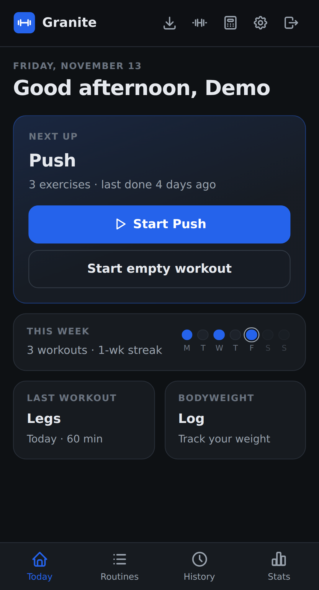
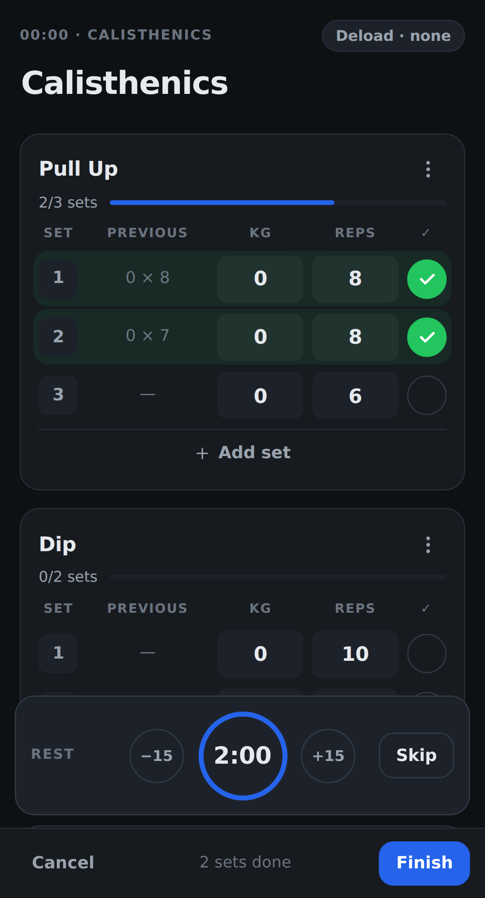
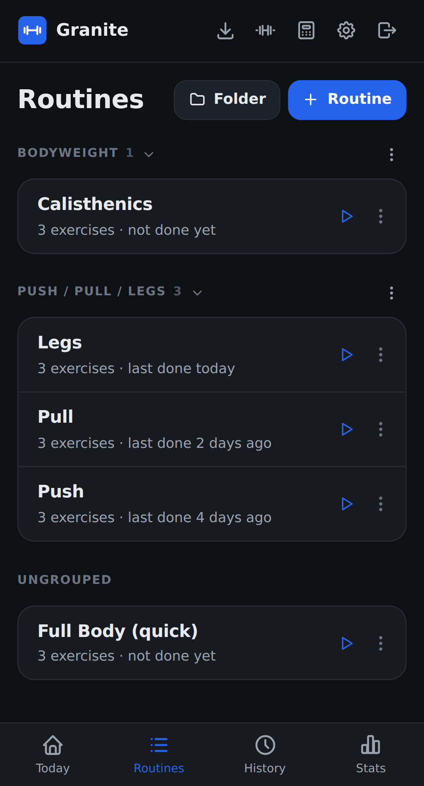
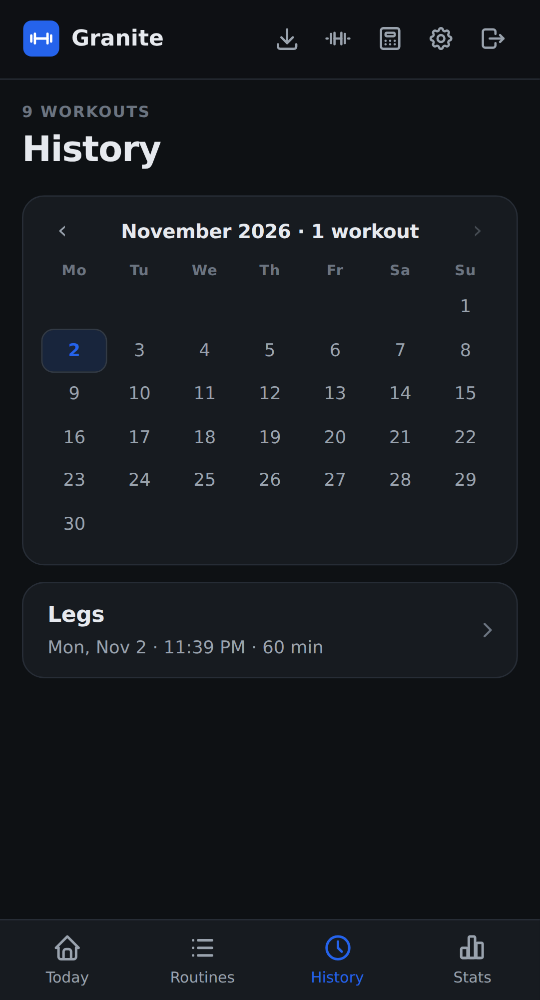
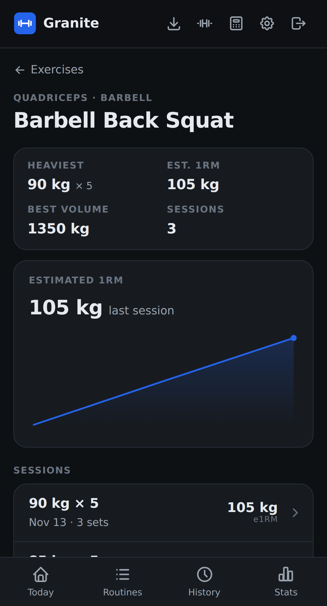
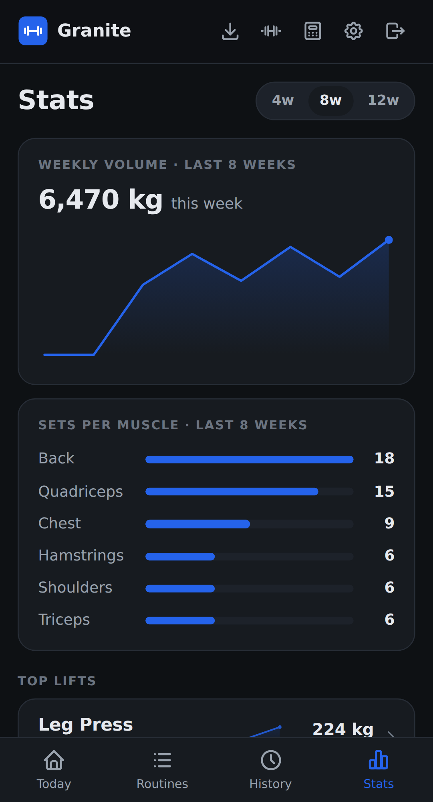

# Granite

> Open-source, self-hostable, **offline-first** workout tracker. Own your training data.
> A clean gym logger you run yourself.

[](https://github.com/MorrisMorrison/granite/actions/workflows/ci.yml)
[](https://codecov.io/gh/MorrisMorrison/granite)
[](https://morrismorrison.github.io/granite/)
[](LICENSE)

**Status:** in active development, in the open, and not yet at 1.0. See the
[roadmap](https://morrismorrison.github.io/granite/project/roadmap/) and the
[releases](https://github.com/MorrisMorrison/granite/releases).

## What it is

Granite lets you build routines, log workouts at the gym (even with no signal), and track your
progress — and lets you **run the whole thing on your own server** so your data is yours. It's
mobile-first with a web app, a public REST API, and an MCP server.

- **Offline-first** — every core action works with no network; changes sync to your server when online.
- **Yours to host** — one Go binary + a SQLite file behind a reverse proxy. JSON export/import, no lock-in.
- **One codebase** — a SvelteKit static build serves as the web app and the Android app (Capacitor); iOS later.
- **AGPL-3.0** — genuinely open, even when run as a service.

The reasoning behind each major choice lives in the [Architecture Decision Records](docs/decisions/).

## Screenshots

<!-- Auto-generated from a demo-data instance by the "README screenshots" CI job on
     every push to main; published to the `screenshots` branch (see
     .github/workflows/ci.yml). Do not edit by hand. -->

<table align="center">
  <tr>
    <td align="center"><br /><sub>Today</sub></td>
    <td align="center"><br /><sub>Workout logger</sub></td>
    <td align="center"><br /><sub>Routines</sub></td>
  </tr>
  <tr>
    <td align="center"><br /><sub>History</sub></td>
    <td align="center"><br /><sub>Exercise detail</sub></td>
    <td align="center"><br /><sub>Stats</sub></td>
  </tr>
</table>

## Run it yourself (self-hosting)

Granite is one container that serves the API and the web app from a single SQLite file.

```sh
cd deploy
cp .env.example .env
# edit .env: set GRANITE_JWT_SECRET (openssl rand -base64 48) and GRANITE_BASE_URL
docker compose up -d
```

Open `GRANITE_BASE_URL` and register. The first account can always be created.

The [quick start](https://morrismorrison.github.io/granite/getting-started/quick-start/) has the details, and
the [self-hosting guide](https://morrismorrison.github.io/granite/self-hosting/install/) covers HTTPS, backups,
and upgrades.

### Android app

The same app as a native Android build, with a rest-timer notification that works with the screen locked.
For now, install a test build: download the `granite-debug-apk` artifact from the latest
[Android CI run](https://github.com/MorrisMorrison/granite/actions/workflows/android.yml) on a PR (needs a
GitHub login; artifacts expire after 14 days). Signed APKs on GitHub Releases are coming. On first launch the app asks for your server address — use `http://`
for a plain-HTTP LAN server (HTTPS recommended). See [Mobile app](docs/technical/mobile-app.md).

## Documentation

**<https://morrismorrison.github.io/granite/>** has the
[user guide](https://morrismorrison.github.io/granite/user-guide/logging-a-workout/), the
[self-hosting guide](https://morrismorrison.github.io/granite/self-hosting/install/), and the
[REST API reference](https://morrismorrison.github.io/granite/api/). The site is generated from
[`docs/`](docs/README.md), which also holds the Architecture Decision Records.

## Development

Building Granite locally — repo layout, dev servers, build & test, the e2e harness — is documented in
**[docs/project/development.md](docs/project/development.md)**.

## Contributing

Granite is built in the open and contributions are welcome — see **[CONTRIBUTING.md](CONTRIBUTING.md)**.
To report a security issue, see [SECURITY.md](.github/SECURITY.md).

## License

[AGPL-3.0](LICENSE).
