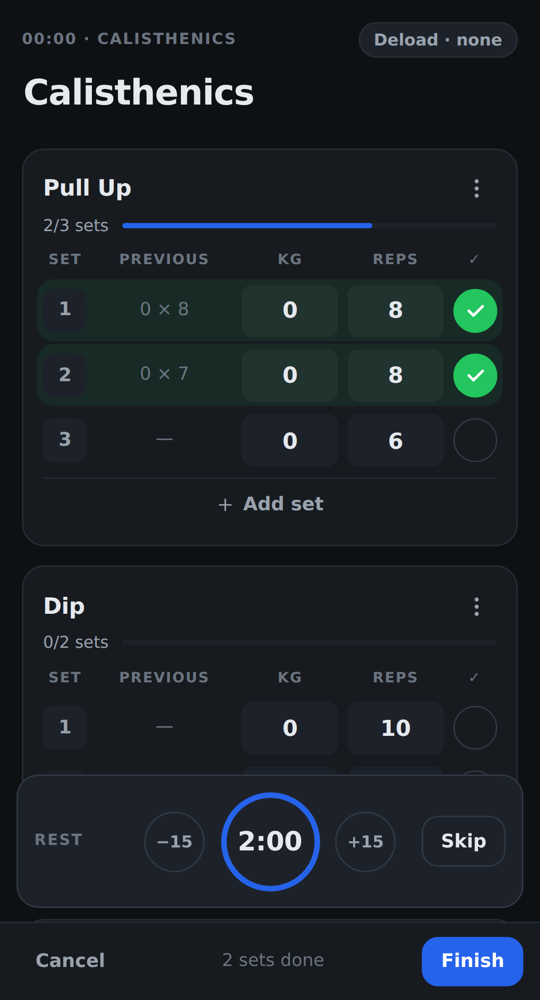
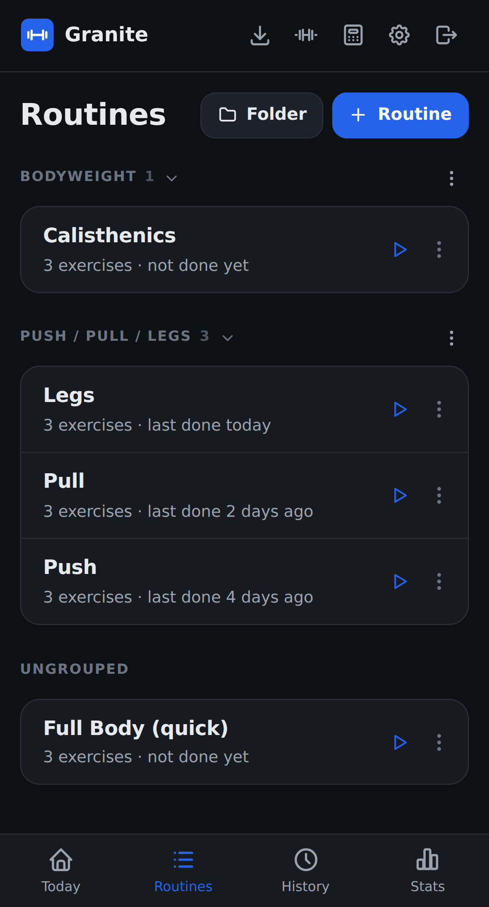
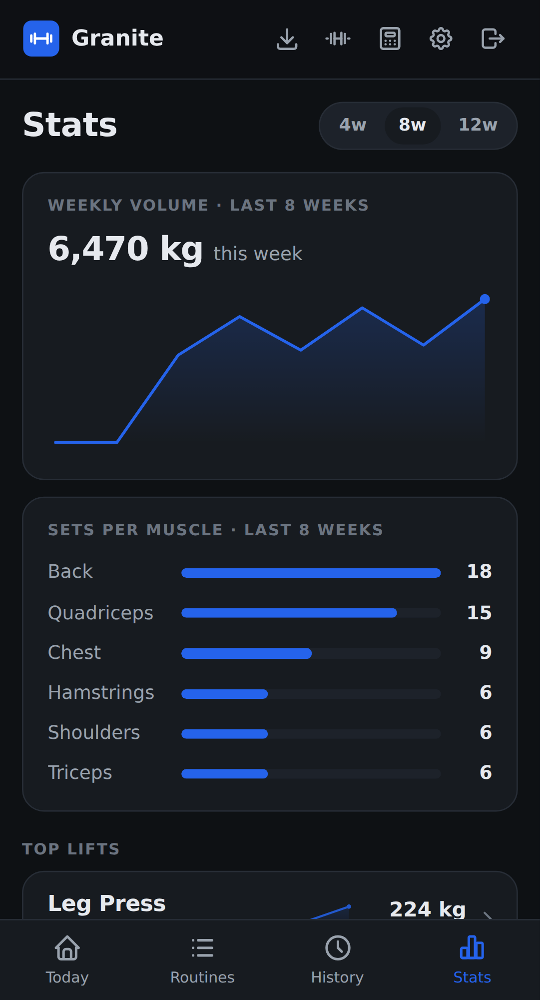

import { Card, CardGrid } from '@astrojs/starlight/components';

<CardGrid>
	<Card title="Built for the gym floor" icon="rocket">
		See what you lifted last time, tick off sets, and let the rest timer run. Logging never gets in the way of your workout.
	</Card>
	<Card title="Works without signal" icon="approve-check">
		Every core action works offline. Your changes sync as soon as you're back online.
	</Card>
	<Card title="See your progress" icon="star">
		Personal records, estimated 1RM trends, weekly volume, and sets per muscle, all from your own history.
	</Card>
	<Card title="Your data stays yours" icon="seti:lock">
		Run it on a Raspberry Pi, a NAS, or a small VPS. Export everything as JSON at any time.
	</Card>
</CardGrid>

## See it in action

<div class="shots">
	<figure>
		
		<figcaption>Log your sets</figcaption>
	</figure>
	<figure>
		
		<figcaption>Plan your routines</figcaption>
	</figure>
	<figure>
		
		<figcaption>Follow your progress</figcaption>
	</figure>
</div>

## Up and running in minutes

Granite is a single container with one data file, so there's no separate database to run.

```sh
docker compose up -d
```

The [quick start](/granite/getting-started/quick-start/) walks you through it, including the two files you need. Then [add Granite to your phone](/granite/getting-started/install-on-your-phone/) and you're ready for your next session.

## Learn more

<CardGrid>
	<Card title="User guide" icon="document">
		Logging workouts, routines, stats, and importing your history. [Read the guide](/granite/user-guide/logging-a-workout/)
	</Card>
	<Card title="Self-hosting" icon="setting">
		Configuration, backups, and running Granite on your own server. [Set it up](/granite/self-hosting/install/)
	</Card>
	<Card title="API reference" icon="puzzle">
		Script your own data with the REST API. [Browse the API](/granite/api/)
	</Card>
	<Card title="Technical docs" icon="open-book">
		Architecture, sync, and the data model. [Explore the internals](/granite/technical/architecture/)
	</Card>
</CardGrid>
