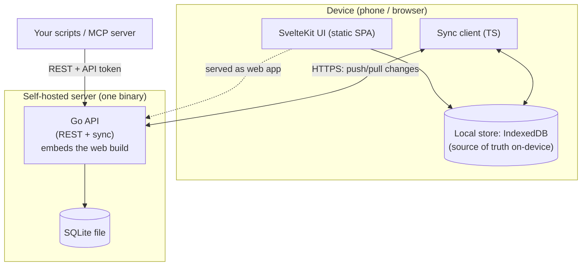

# Architecture

## Big picture



**The key idea:** the device holds a **full local copy** of your data and reads and writes it directly, so
the UI is instant and works with the network off. A background **sync client** reconciles the local DB
with the server. The server is "just" durable storage + the sync endpoint + the API.

This is what makes offline-first cheap to reason about: the UI never talks to the network on the hot
path. It talks to the local store. Sync is a separate, retryable concern.

## Components

### `apps/api` — Go service
- **REST API** for sync + direct CRUD (also what the web/mobile client and third parties use).
- **Sync engine** — the push/pull endpoint and conflict resolution (see [Sync and offline](sync-and-offline.md)).
- **Embeds the web build** via Go `embed`, so a self-hoster runs a single binary that serves both the
  API and the web app.
- **Storage:** a **SQLite** file (see [ADR-0004](../decisions/0004-sqlite-everywhere.md)).
- **Auth** — issues/validates JWTs (see ADR-0006).

### `apps/mobile` — SvelteKit + Capacitor
- A **SvelteKit app built static** (`adapter-static`, SPA fallback). No SSR/Node server at runtime.
- That single build is consumed two ways:
  1. **Capacitor** wraps it into the Android app, with native notification and keep-awake plugins.
  2. The **Go binary embeds it** to serve the self-hosted web app / PWA.
- On-device storage sits behind a `SyncStore`/repository seam. The web app and the Android app both use
  **IndexedDB** (see [ADR-0010](../decisions/0010-web-local-store-indexeddb.md)).

### `apps/mcp` — MCP server
- A separate Node process that runs next to an MCP client and talks to a Granite server over the REST
  API with a personal API token. See [MCP server](../integrations/mcp-server.md).

### `packages/shared` — TypeScript
- The **generated API client** (from the server's OpenAPI spec) — type-safe calls, no hand-written DTOs.
- **Shared domain types** and the **sync client logic**, written once and used by mobile + web (they're
  the same build, but this keeps sync logic isolated and testable).

## The contract: OpenAPI between Go and TS

Backend is Go, frontend is TS, so we don't get shared types for free. We bridge it:

```
Go handlers + annotations  ──►  OpenAPI spec (checked into repo)  ──►  generated TS client (packages/shared)
```

- The **OpenAPI spec is the source of truth** for the wire format.
- CI fails if the spec drifts from the code, and regenerates the TS client.
- Net effect: end-to-end type safety across a Go/TS boundary, without a TS backend.

## Storage on the server and the device

The **server** runs **SQLite**, keeping it tiny (no separate database process). See
[ADR-0004](../decisions/0004-sqlite-everywhere.md) for why, and how Postgres can be slotted in later as an
optional backend. On the device the sync engine is **store-agnostic** (it talks to a `SyncStore` over
opaque `entity:id` records), so the on-device engine doesn't have to match the server's: the web client
uses IndexedDB ([ADR-0010](../decisions/0010-web-local-store-indexeddb.md)), and a native SQLite store
could be added as another `SyncStore`.

## Tech stack

| Layer | Choice | Notes |
|---|---|---|
| API language | **Go** | Single static binary that embeds the web build. ADR-0001. |
| HTTP | **chi** + **huma** | Routing, plus the OpenAPI spec generated from the handlers. ADR-0007. |
| Storage | **SQLite** | ADR-0004. A pure-Go driver (`modernc.org/sqlite`) keeps the binary CGO-free. |
| Migrations | **goose** | Plain SQL, run automatically on startup. |
| Frontend | **SvelteKit** (`adapter-static`) | One static SPA build. |
| Mobile shell | **Capacitor** | Android app with native plugins. ADR-0002, ADR-0012. |
| Device store | **IndexedDB** | Behind a `SyncStore` seam. ADR-0010. |
| Client package manager | **pnpm** workspaces | JavaScript monorepo. |
| API contract | **OpenAPI 3.1** | Generates the TypeScript client. |
| Charts | Small in-house Svelte components | `LineChart` and `Sparkline`, with no chart dependency. |

## Error handling convention

The API returns a typed error envelope `{ error, code, details }` with a correct HTTP status, mapped
from a backend error taxonomy (NotFound→404, Validation→400, AlreadyExists→409, Unauthorized→401,
Forbidden→403, …). No string-matching on error messages for status mapping; **never** leak raw internal
errors to clients. Clients branch on `code`/HTTP status, not message strings. Genuine internal failures
return a generic 500 (cause logged server-side, not returned).

## Deployment

- **One image.** The Go binary embeds the SvelteKit static build, so there's no separate web container and no Node at runtime. A pure-Go SQLite driver keeps the binary CGO-free and easy to cross-compile.
- **Docker build.** A multi-stage build compiles the web app, then the Go binary with the web assets embedded, into a small Alpine image. GitHub Actions publishes it to GHCR for `linux/amd64` and `linux/arm64`.
- **Startup.** The container starts as root only long enough to make the data folder writable, then drops to the non-root `granite` user.
- **Shutdown.** On `SIGINT` or `SIGTERM` the server stops accepting connections, drains in-flight requests for up to 15 seconds, then closes SQLite cleanly, so restarts don't corrupt the database or drop a request mid-write.
- **Footprint.** The heavy read and stats work happens on the client, because each device keeps a full local copy. The server stays light even with a long history.

## Why this shape

- **Offline-first** demands a local DB + sync; everything above follows from that.
- **One UI build** for mobile + web kills duplicate frontends.
- **Single Go binary + a SQLite file** is the smallest thing a self-hoster can operate.
- **OpenAPI** keeps the Go/TS split honest.

See the [decision records](../decisions/) for the trade-offs behind each pillar.
