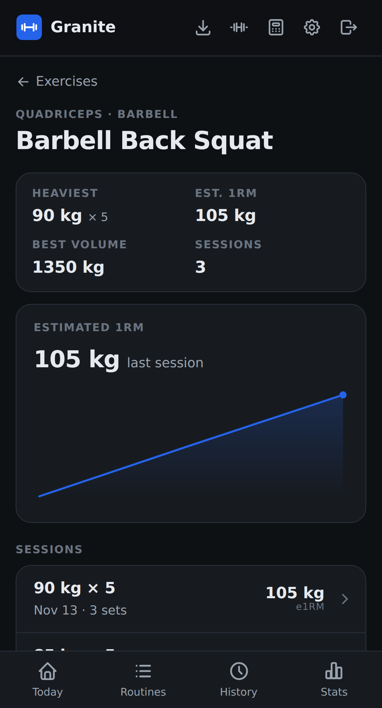

# Exercises

Granite comes with a library of common exercises, grouped by muscle. Open it from the icons at the top of the screen. Use the search field to find one quickly.

## Exercise progress

Tap an exercise to see your heaviest set, your best estimated 1RM, your best session volume, a chart of your estimated 1RM, and every session you've done it. Tap a session to open that workout.

## Add your own

Tap **New**, give the exercise a name, and choose its type, primary muscle, and equipment. You can also create one while picking an exercise for a routine or workout. Custom exercises are marked **Custom** in the list.

To change one, open it and choose **Edit** from the **⋯** menu.

## Archive and restore

Archiving hides a custom exercise from your library, and your past workouts keep it. Open the exercise and choose **Archive** from the **⋯** menu. To bring it back, open **Archived** at the bottom of the list, open the exercise, and choose **Restore**.

Built-in exercises can't be edited or archived.
