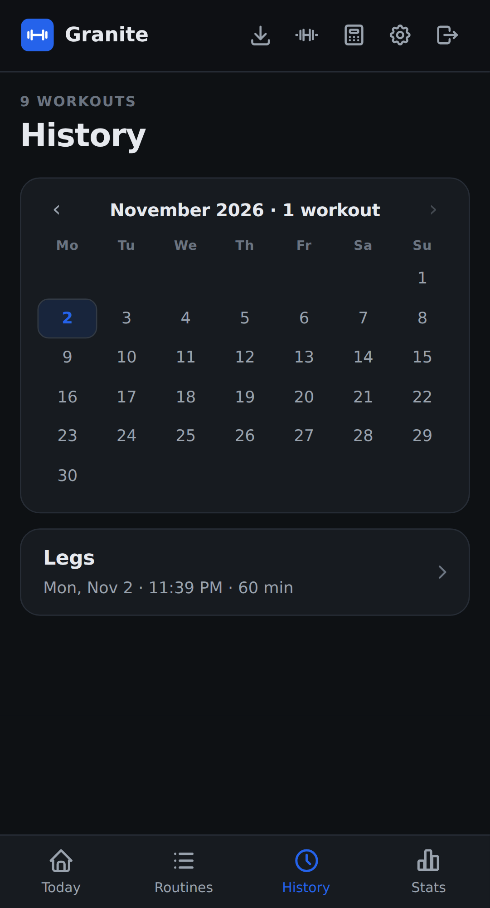
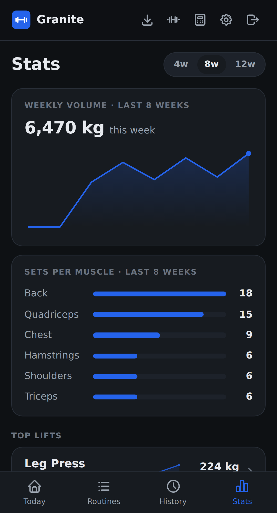

# History and stats

## History

**History** shows a calendar of your training, with the month's workouts below it. Use the arrows to change month, and tap a marked day to see only that day.

Tap a workout to see its duration, sets, and volume, along with every set you did. If you log your bodyweight, your closest entry appears there too. Tap an exercise name to see its progress. You can delete a workout from the bottom of this page.

## Stats

**Stats** gives you the bigger picture. Use the **4w**, **8w**, and **12w** switch to change the range of the first two cards.

- **Weekly volume:** total weight lifted per week, in working sets.
- **Sets per muscle:** how your working sets are spread across muscle groups.
- **Top lifts:** your main lifts, with their estimated 1RM trend.
- **Recent PRs:** your latest personal records.
- **All-time records:** your best estimated 1RM for every lift.

## How the numbers work

Volume and records count completed working sets only, so warm-ups and skipped sets are left out.

The estimated 1RM uses the Epley formula: `weight × (1 + reps / 30)`. It's an estimate of what you could lift for one rep, and it's mainly useful for comparing your progress over time.
