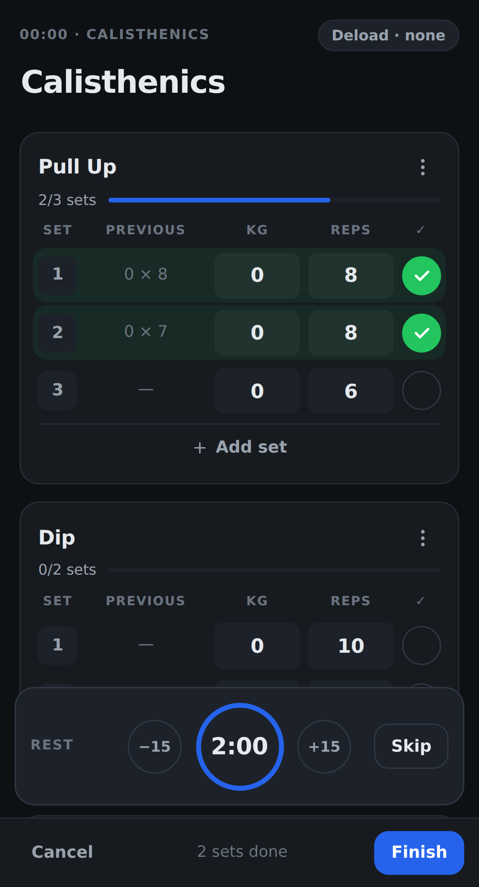

# Logging a workout

The logger is built for use between sets: open it, tick off your sets, and finish.

## Start a workout

On **Today**, tap **Start** on the suggested routine, or **Start empty workout** to build the session as you go. You can also start any routine from **Routines**.

Everything works offline, so a bad gym connection won't get in your way. If you close the app mid-workout, Granite offers to resume it next time.

## Log your sets

Each exercise has one row per set:

- **Previous** shows what you lifted in that set last time.
- **KG** or **LB** and **Reps** hold this session's numbers. A routine fills in its targets.
- The round button marks the set as done and starts the rest timer.

Use **Add set** for an extra set. Tap **Add exercise** to add another exercise, or create a new one on the spot.

## Change a set type

Tap the set number to choose a type, or to delete the set:

| Badge | Type |
|---|---|
| `1`, `2`, `3` | Normal working set |
| `W` | Warm-up. Warm-ups don't count towards your numbered sets, volume, or records. |
| `D` | Drop set |
| `F` | Failure set |

## Rest timer

The timer starts when you mark a set as done. It uses the exercise's rest time from the routine, or your default from **Settings**. Use **−15** and **+15** to adjust it, or **Skip** to end it. Granite beeps and vibrates when rest is over, where your device allows it.

The timer runs on real time, so it stays correct if your phone locks. Browsers can't reliably alert you while the screen is off, though.

## Plates

For barbell exercises, open the **⋯** menu on the exercise and choose **Plates**. It shows what to load on each side of the bar for your next set.

## Deload

When you start from a routine, the **Deload** button at the top lowers the routine's weights by 5, 10, 15, or 20%. Choosing **None** restores the originals.

## Finish

Add notes to the session if you like, then tap **Finish**. **Cancel** discards the workout after asking you to confirm.
