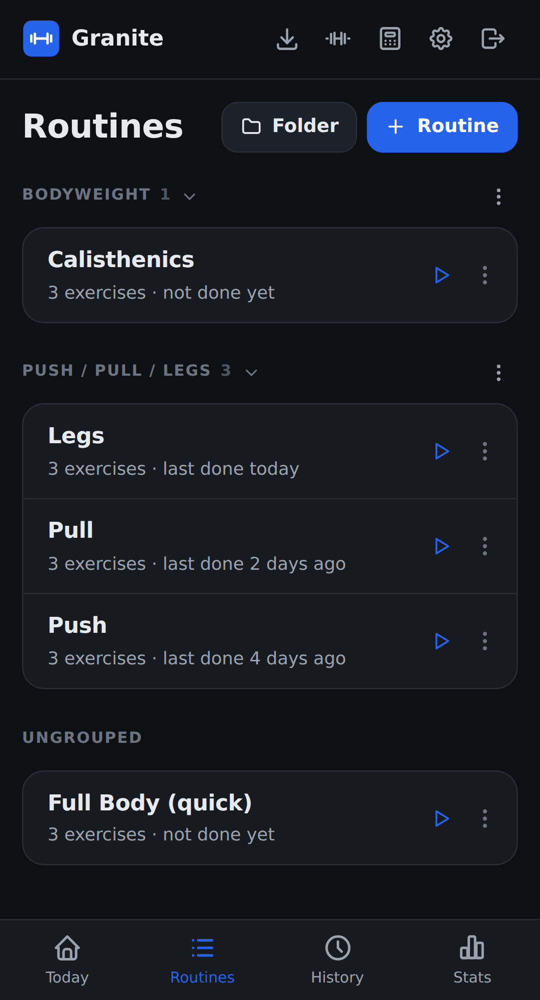

# Routines

A routine is a saved workout you can start in one tap, with its exercises, target sets, and rest times.

## Create a routine

1. Go to **Routines** and tap **Routine**.
2. Give it a title and, if you like, notes and a folder.
3. Tap **Add exercise** and search for what you need.
4. Set the rest time and the target weight and reps for each set.
5. Tap **Create routine**.

Tap a set number to change its type or delete it.

## Add warm-ups

Open an exercise's **⋯** menu and choose **Add warm-ups**. Granite builds a ramp up to your heaviest working set, so that set needs a target weight first.

## Organize with folders

Tap **Folder** to create one, for example "Push / Pull / Legs". To move a routine, open its **⋯** menu and pick a folder. Tap a folder's name to collapse it. Deleting a folder keeps its routines and moves them to **Ungrouped**.

## Other actions

The **⋯** menu on a routine also lets you duplicate or delete it. Tap the routine itself to edit it, and tap the play button to start it.

## How "Next up" works

**Today** suggests the routine you did longest ago in the same folder as your last workout, and routines you've never done come first. If you run Push, Pull, and Legs from one folder, Granite follows that rotation by itself.
